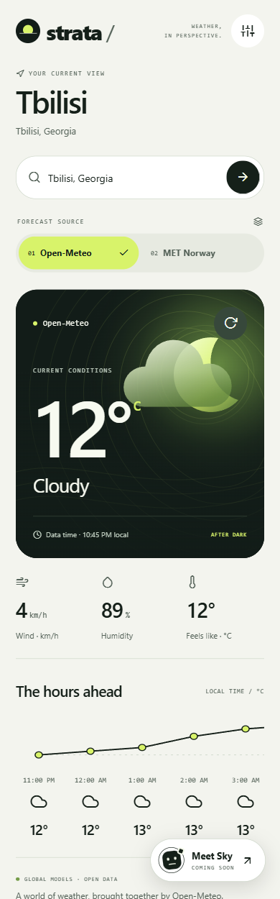
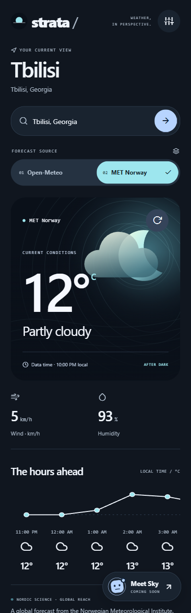

<p align="center"></p>
<h1 align="center">Strata Weather</h1>
<p align="center">Two weather services. A considered mobile experience.</p>
<p align="center">React Native 0.88 · TypeScript 6 · Expo SDK 58 · Android / iOS / Web</p>

Strata lets you search for a city, choose the right location, and compare forecasts from **Open-Meteo** and **MET Norway**. Switching the source automatically updates the forecast for your selected place and changes the visual atmosphere. Both integrations work without API keys.

Make it yours with **six light and dark themes**, or meet **Sky**, a playful coming-soon assistant with local scripted replies. Appearance, forecast source, and conversation state stay independent.

The project is designed to be understood and extended: remote APIs stop at typed adapters, application logic depends on contracts, and the UI consumes one normalized weather model.

<p align="center">


</p>

Mobile-width web previews show Studio with Open-Meteo and Midnight with MET Norway using live data. They are not native-device test evidence.

## Start in a minute

Use Node.js 22 and npm. No environment file, API key, or account is needed.

```sh
git clone https://github.com/BeqaDeveloper/strata-weather.git
cd strata-weather
npm ci
npm run web
```

Search for a place or select **Explore Tbilisi**, then switch sources. Weather requests happen after a location is selected; typing alone never calls an API.

For a native development build, configure the Android SDK or use macOS with Xcode, then run:

```sh
npx expo run:android
npx expo run:ios
```

After installing the development build, `npm run start:dev` starts its server. `npm run start:go` targets Expo Go when its installed version supports SDK 58. Native modules are included in the project; SDK compatibility should be checked before selecting Expo Go.

Android and iOS are the primary targets. Browsers control the User-Agent header, so direct MET requests can depend on the browser origin. Both services were checked successfully in the local browser preview; see [provider integration](docs/providers.md) for deployment requirements.

## What the app does

- Resolves international city names and postal codes into explicit location choices.
- Shows temperature, conditions, humidity, wind, available feels-like measurements, and upcoming forecasts in local time.
- Changes data and visual identity when the selected service changes.
- Cancels obsolete requests and isolates cached reports by provider and location.
- Handles timeouts, invalid payloads, rate limits, provider outages, offline pauses, and recovery.
- Retains and labels the last available report after a failed refresh.
- Resumes paused native requests after reconnection and refreshes stale data on foreground return.
- Provides accessible controls, scalable text, safe areas, and responsive layouts.
- Offers six complete semantic appearance presets that work with either provider, including themed recovery and assistant screens.
- Includes an honest local assistant preview with authored coming-soon replies, validated input, and a bounded session conversation.

There is no silent provider fallback. The selected service remains identifiable, including when it fails. Unsupported measurements and unknown daylight are represented explicitly rather than guessed.

## Architecture you can extend

```text
App.tsx                         App session and native lifecycle
src/
  bootstrap/                    Validated composition and recovery boundary
  domain/                       Provider contracts, weather model, validation, errors
  application/                  Search, selection, query identity, retry policy
  infrastructure/
    http/                       Abortable transport, freshness cache, diagnostics
    location/                   Geocoding adapter
    providers/                  Weather API decoders and unit normalization
  presentation/                 Weather experience, vector scene, forecast geometry
  features/assistant/           Local coming-soon interaction and validated preview model
  platform/                     Native focus and connectivity integration
  shared/
    ui/                         Reused controls, notices, and visual tokens
    theme/                      Semantic palettes, session selection, and themed styles
    observability/              Typed logger, privacy filtering, replaceable sink
```

Dependencies point toward the domain. `bootstrap/createApplication.ts` is the only place that pairs concrete weather adapters with presentation definitions. The catalog rejects duplicate IDs, mismatched themes, and invalid defaults before the screen runs. ESLint enforces the module boundaries.

To replace a service, implement `WeatherProvider`, validate and normalize its response, define its visual presentation, and register that pair in the composition root. Search, source switching, cache isolation, and weather components stay reusable. See the [replacement guide](docs/providers.md).

Shared code has a specific purpose: `ActionButton`, `IconButton`, `StatusNotice`, visual tokens, and the structured logger are reused building blocks. Weather-specific calculations stay beside the feature; there is no catch-all utilities module.

## Decisions that matter

**Server state has one owner.** TanStack Query manages requests and caches. React state manages editable input and selection. A separate global state framework would add coordination without solving a requirement here.

**Rendering follows data changes.** The expensive weather card, vector scene, and forecast section are memoized. Stable controller actions let input edits update the search UI without redrawing the weather scene. Render-isolation tests verify that behavior. There are no animation loops, remote artwork requests, or invented chart values.

**Failures are part of the model.** Known transport failures have stable error codes and a bounded retry policy. Unexpected defects remain distinct from network errors. Malformed cached responses are evicted so a subsequent retry can recover. The application boundary keeps unexpected render failures recoverable.

**Logging has an explicit boundary.** Development logs expose allowlisted event names, endpoint categories, durations, statuses, and failure codes. They exclude search terms, coordinates, URLs, payloads, headers, exception messages, and stacks. Production defaults to a silent sink; a reporting adapter can be injected without changing features. Reporting failures cannot break weather requests.

**Capabilities stay honest.** Feels-like and daylight can be absent. MET's missing measurements are not estimated just to fill the interface. The forecast trace uses the actual spacing between timestamps, including uneven forecast intervals.

**Appearance is configuration.** Six palettes use shared semantic roles. Adding a preset extends the typed catalog and automatically adds a chooser option and contrast checks. Theme changes preserve service instances and the selected forecast. The forecast trace and its readings share one scrollable time axis.

**The assistant is a preview.** Sky gives authored coming-soon replies. Messages are validated, retained only in a bounded session transcript, and never sent to a model or included in logs.

Read [architecture and engineering](docs/architecture.md) for dependency rules, lifecycles, rendering decisions, logging integration, and extension examples.

## Verify the project

```sh
npm run check
npm run doctor
npm run export:all
```

`check` runs strict TypeScript, ESLint, formatting, and offline unit tests with coverage gates. The suite covers provider decoding, request cancellation, cache recovery, source switching, offline resumption, configuration invariants, safe logging, rendering isolation, and UI interactions. See [testing](docs/testing.md) and the [verification record](docs/verification.md) for current results and device-testing limits.

Independent agent architecture and privacy reviews informed this revision. Findings led to concrete fixes for registration consistency, malformed cache recovery, offline states, daylight truthfulness, and reporting resilience. This describes the review process; it is not a claim of human certification.

## Documentation

- [Architecture and engineering](docs/architecture.md) — boundaries, rendering, lifecycle, and observability.
- [Provider integration](docs/providers.md) — add or replace an API, capabilities, caching, and attribution.
- [Theming](docs/theming.md) — six presets, semantic roles, contrast checks, and adding an appearance.
- [Assistant preview](docs/assistant-preview.md) — copy, validation, retention, privacy, and future integration boundaries.
- [Testing](docs/testing.md) — commands, behaviors to preserve, and device checklist.
- [Verification](docs/verification.md) — completed checks and known limits.
- [CI setup](docs/ci.md) — the ready-to-enable workflow; kept as a template by the repository owner's choice.
- [Security](SECURITY.md) — privacy, upstream tooling advisories, and reporting.
- [Contributing](CONTRIBUTING.md) — naming, boundaries, and change requirements.

## Scope and license

Values are model forecasts. Temperatures use Celsius and wind uses km/h. Data is held in memory for the current session. Saved places, device geolocation, background polling, and signed store releases are outside this implementation.

Application code is MIT licensed. Weather and location data keep their own attribution and service terms. Open-Meteo's free API is intended for non-commercial evaluation; review the [provider terms](docs/providers.md#licensing-and-deployment) before commercial distribution. Known upstream Expo tooling advisories are documented in [SECURITY.md](SECURITY.md).
