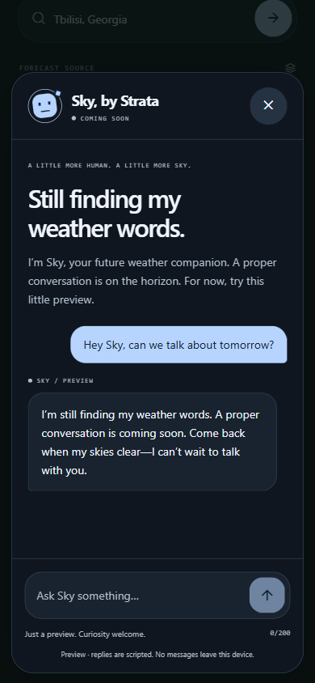

# Sky assistant preview

Sky is a local coming-soon interaction, not a connected AI service. Its launcher and chat panel always identify the feature as coming soon, and the panel explains that replies are scripted. It does not answer weather questions or claim a model is currently being trained.

The replies are deliberately authored in Strata's voice: Sky is still finding its weather words and looks forward to a future conversation. There are three rotating replies, two starter suggestions, and no artificial network delay or typing timer.

## Boundaries

`src/features/assistant/assistantPreview.ts` owns input normalization, validation, reply copy, and bounded exchange creation. `WeatherAssistantWidget.tsx` owns modal and composer state. `SkyMark.tsx` contains the feature's original vector mark.

The feature consumes shared theme tokens and controls. It does not import weather adapters, log prompts, perform requests, or persist messages. App.tsx composes it beside the weather experience. Import rules keep feature UI out of domain, infrastructure, and shared modules.

## Input and retention

- Input is normalized with NFKC, trimmed, and whitespace collapsed.
- Blank or non-visible-only messages are rejected.
- The normalized message limit is 200 Unicode code points.
- A valid send appends one user message and one authored reply synchronously.
- The transcript retains the newest six complete exchanges.
- Closing and reopening the panel preserves the session conversation. Reloading or restarting the app clears it.
- No prompt content is sent to a server, stored on disk, or included in application logs. Weather and geocoding retain their separate documented network behavior.

The widget is memoized so unrelated weather-input renders do not redraw it. Its own state and theme context still update normally. Phone and tablet layouts use safe-area spacing, a bounded panel, and a scrolling transcript; native back and explicit close controls dismiss the modal.

## Tests and future work

Tests cover validation, international input, reply selection, retention limits, opening and closing, suggestions, keyboard submit, theme changes, and App-level separation from weather requests. Browser and native-device checks should include keyboard resizing, Escape/back dismissal, focus restoration, and new-message announcements.

A real assistant would need a deliberate service contract, a backend for credentials, failure and cancellation handling, and clear data-use choices. This preview does not pretend those systems exist. Introduce them when the feature becomes an actual product requirement; do not route credentials or raw prompt telemetry through the mobile bundle.
