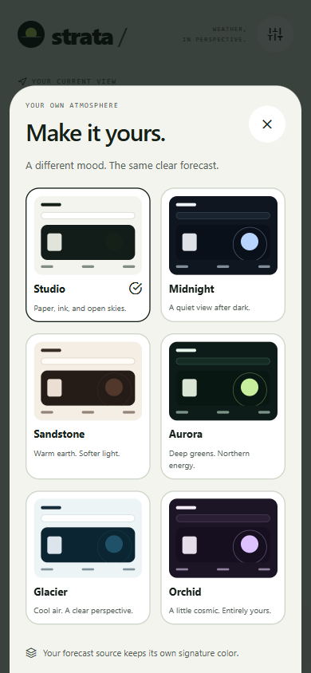

# Appearance and theme extension

The app has six complete appearance presets: Studio, Midnight, Sandstone, Aurora, Glacier, and Orchid. Use **Customize appearance** in the header to preview and select one. Three are light and three are dark. Preference is held for the current app session and resets on restart.

Appearance is independent from the forecast source. Open-Meteo keeps its lime signature and MET Norway keeps its glacier signature across every preset. Selecting a new appearance does not change location, recreate services, or request weather again. Both the status bar and the recovery screen follow the selected appearance.



## Ownership

`src/shared/theme/themes.ts` owns the typed preset catalog and semantic colors. ThemeId is derived from that catalog, so adding a preset does not require maintaining a separate identifier union. ThemeProvider owns session selection and exposes `useAppTheme()` and `useThemedStyles(factory)`.

The palette describes meaning: canvas, paper, ink, muted text, separators, segmented controls, scene surfaces and text, error surfaces, action foregrounds, and modal scrims. Components request those roles rather than testing whether the selected preset is called Midnight or Orchid.

Style factories stay at module scope. `useThemedStyles` memoizes their results by factory identity and the current theme. The context value and selection action are stable between appearance changes. Theme changes redraw relevant context consumers, including already open assistant content, without rebuilding the query runtime.

Weather scene colors combine semantic scene surfaces with the selected provider's accent. Provider-safe dark ink is used on the light lime and cyan source fills even when the app has a dark background. This avoids assuming that a dark-theme foreground is suitable for every source badge.

## Add a preset

1. Add a definition to the catalog in `src/shared/theme/themes.ts` with an ID, name, short description, dark-mode flag, and a complete semantic palette. Spreading an existing palette is acceptable when all changed roles are reviewed together.
2. Use readable foreground/background pairs, including muted text, inputs, errors, action labels, and scene captions. The parameterized contrast tests automatically include the new preset and require at least 4.5:1 for their normal-text pairs.
3. Run the theme tests and the full quality check, then inspect the preset with both weather providers, an open assistant conversation, an error state, and the appearance sheet itself.
4. Verify keyboard appearance, large text, safe areas, and screen-reader focus on native devices before distributing a release.

The appearance chooser is generated from the catalog. No switch statement or new screen branch is needed. Presets are readonly TypeScript configuration; consumers should not mutate them.

## Add a themed component

```tsx
const createStyles = ({ colors }: AppTheme) =>
  StyleSheet.create({
    container: { backgroundColor: colors.paper },
    label: { color: colors.ink },
  });

function ForecastNote() {
  const styles = useThemedStyles(createStyles);
  return <Text style={styles.label}>A little more perspective.</Text>;
}
```

Use the shared controls when their behavior fits. Keep weather-specific geometry and assistant-specific interaction inside their feature modules. Do not move unrelated functions into the theme provider.

## Verification scope

Automated tests cover catalog identities, selection, memoized styles, semantic contrast, modal controls, and preservation of weather state. Contrast checks describe the tested color pairs; they do not certify every illustrated pixel, platform dialog, or assistive-technology interaction. System-managed UI may follow platform or keyboard preferences.
